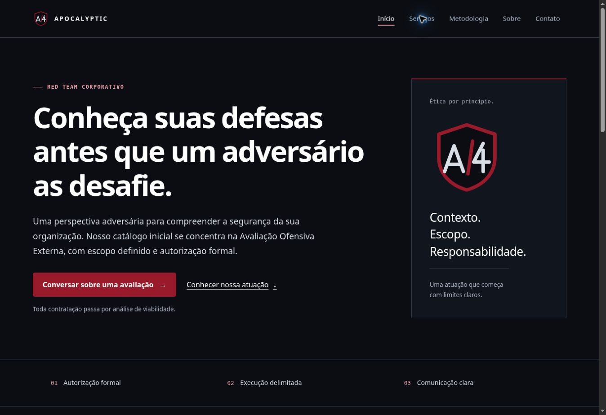

# Relatório AP-004 — evolução corporativa

Data: 14/11/2026, horário de Manaus.

## Base e autorização

Implementação em desenvolvimento autorizada pelo fundador. Publicação em produção não autorizada.

A branch `feat/ap-004-evolucao-corporativa` parte de `fix/ap-003-contatos-comerciais` no commit `cd64d097133fcb84b73ff17feaf0c4f23dceb3be`. A base da AP-003 está um commit à frente de `feat/site-institucional-v1`.

A PR AP-004 aponta para a branch de contatos. `main`, `feat/site-institucional-v1` e a branch da AP-003 não receberam commits desta implementação.

O relatório AP-002 foi recuperado e consultado. Seus achados de contato, contraste, menu curto, semântica, rotas e documentação orientaram a implementação.

## Implementação

| Requisito | Entrega |
| --- | --- |
| AP-003 | Destinatários, mensagem de WhatsApp, assunto de e-mail e proteção da nova aba preservados. |
| AP-004.1 | Identidade Crimson Defense, estilo Corporativo Premium, SVGs A/4 originais e fontes de sistema. |
| AP-004.2 | Mensagem principal aprovada; atuação, metodologia e contato; texto primeiro no layout mobile. |
| AP-004.3 | Catálogo conservador de Avaliação Ofensiva Externa, condicionado à viabilidade, ao escopo e à autorização. |
| AP-004.4 | Menu com rolagem própria e teclado, foco visível, contraste, movimento reduzido, conteúdo sem dependência de JavaScript. |
| AP-002 | Página 404, sitemap XML, metadados, títulos sem saltos e documentação do fluxo real de revisão. |

Não foram criados clientes, depoimentos, certificações, estatísticas ou capacidades operacionais não comprovadas. As entregas do serviço são apresentadas como condições a definir em proposta.

## Arquivos

- `index.html`, `servicos.html`, `metodologia.html`, `sobre.html`, `contato.html`: conteúdo e estrutura corporativos.
- `css/styles.css`: sistema visual, responsividade, foco e tratamento do menu.
- `js/main.js`: melhoria progressiva da navegação, Escape e sincronização por breakpoint.
- `404.html`, `sitemap.xml`, `robots.txt`: rotas ausentes e descoberta.
- `tools/preview.mjs`: servidor local, rotas e cabeçalhos para desenvolvimento.
- `tests/static.test.mjs`, `tests/site.test.mjs`: verificações estáticas/HTTP e suíte de navegador.
- `package.json`, `package-lock.json`: ferramentas somente de desenvolvimento.
- `.github/workflows/quality.yml`: verificações de PR sem publicação.
- `README.md`, `docs/DEPLOY.md`, `docs/ESCOPO.md`, este relatório: estado, escopo e limites.
- `docs/screenshots/ap-004-inicio.jpg`: captura da prévia para revisão visual.

`assets/logo.svg`, `assets/favicon.svg` e `_headers` permanecem iguais à base.

## Links para revisão

- [Pull Request #3 — em rascunho, sem merge](https://github.com/bacharelado/-apocalyptic-site/pull/3).
- [Prévia de desenvolvimento da branch](https://feat-ap-004-evolucao-corpora.apocalyptic.pages.dev/).
- [Prévia imutável do código validado](https://9c9391c6.apocalyptic.pages.dev/).
- [CI aprovada — 36 testes](https://github.com/bacharelado/-apocalyptic-site/actions/runs/43632034798).

Código validado pela CI: `c2d332b312b6d7ef804dcd6ae0368a33061212bd`. A atualização final deste relatório e a inclusão da captura não alteram HTML, CSS, JavaScript, testes ou configuração de execução.

## Resultados finais

| Verificação | Resultado efetivo |
| --- | --- |
| `npm run check` | Aprovado localmente e na CI: sintaxe do JavaScript. |
| `npm run test:static` | 11 testes locais aprovados; incluídos na execução completa da CI. |
| `npm test` na CI | **36 aprovados, 0 falhas, 0 ignorados**, execução `43632034798`. |
| Reflow | Seis páginas testadas em 320×568, 390×844, 768×1024, 1366×768 e 340×234 CSS px; sem transbordamento horizontal nos critérios testados. |
| axe / WCAG 2.2 AA | Nenhuma violação detectada pelas regras selecionadas nas seis páginas e no menu aberto em mobile. Isso não certifica conformidade integral com WCAG. |
| Teclado e foco | Tab, saída do menu sem aprisionamento, Escape com restauração de foco, link de salto e transições entre breakpoints aprovados na CI. |
| Sem JavaScript | Navegação e conteúdo das seis páginas aprovados em 320 px; FAQ nativa operável com teclado. |
| Movimento reduzido | Sem animações/transições e sem rolagem suave no cenário automatizado. |
| Contatos | Número, mensagem, e-mail, assunto e `noopener noreferrer` preservados e verificados. Não foram enviadas mensagens. |
| SVGs e favicon | Hash de blob original preservado: `790e86c51cdd37d5cc6890511c17ab28475e96b0`. |
| Links, recursos e cabeçalhos | Destinos internos, carregamento de imagens, ausência de erros da página no cenário testado, CSP, `nosniff` e `DENY` aprovados no servidor de teste. |
| 404 e sitemap | 404 real e XML com cinco URLs aprovados no servidor de teste. Na prévia da hospedagem, a página de erro abriu e o navegador reconheceu o sitemap como `application/xml`. |
| Revisão visual da prévia | Cinco páginas examinadas em desktop; cinco páginas navegadas em zoom de 400%, com viewport 340×234 e largura de conteúdo igual à largura útil de 337 px. FAQ acionada por teclado. |
| Menu na prévia | Cinco links alcançados por Tab dentro da área visível com zoom de 400%; Escape fechou o painel e devolveu o foco ao botão. |
| Inicialização de Chromium local | Bloqueada por restrição de socket do ambiente. A suíte completa foi executada de fato na CI, em ambiente que permitiu iniciar Chromium. |
| Requisições HTTP diretas à hospedagem | Receberam 403 pelo caminho de requisições do ambiente; não se atribuiu a origem do bloqueio nem se certificaram cabeçalhos privados da hospedagem por essa via. A prévia foi navegada com sucesso no navegador disponível. |

Ferramentas de teste: Playwright `1.65.1` e axe-core `4.14.0`; dependências apenas de desenvolvimento. Nenhuma biblioteca de teste é carregada pelos visitantes.

O transbordamento encontrado pela primeira rodada da CI foi corrigido mantendo separadores entre as palavras do cartão A/4 no mobile. O teste de mudança de viewport aguarda o estado ARIA da navegação antes de continuar, evitando duas mudanças coalescidas na mesma frame. A rodada final aprovou todos os testes.

## Registro visual

Captura real da primeira área visível em computador. A fonte, o logotipo e o conteúdo não foram retocados.

## Riscos e validações pendentes

- Confirmar com o fundador que o número informado recebe mensagens no WhatsApp. O número de oito dígitos foi preservado sem adaptação por suposição.
- Confirmar abertura do aplicativo de e-mail e recebimento no dispositivo do responsável.
- Validar com leitores de tela, aparelhos reais e navegadores adicionais antes de afirmar conformidade integral com WCAG.
- Confirmar os cabeçalhos efetivos da hospedagem por um caminho HTTP autorizado e representativo. A configuração privada do provedor não foi acessada.
- Revisar o texto e a viabilidade real do serviço com o fundador.
- Revisar a integração da AP-003 e da AP-004 antes de qualquer aprovação de produção. A PR permanece em rascunho.

## Segurança e publicação

Sem backend, formulário ou dependência de terceiros carregada no site. Não foi flexibilizada a CSP. Não houve testes ofensivos, merge ou alteração de configuração de produção.

A implementação é uma proposta em desenvolvimento para revisão. O fundador mantém a decisão sobre publicação.
